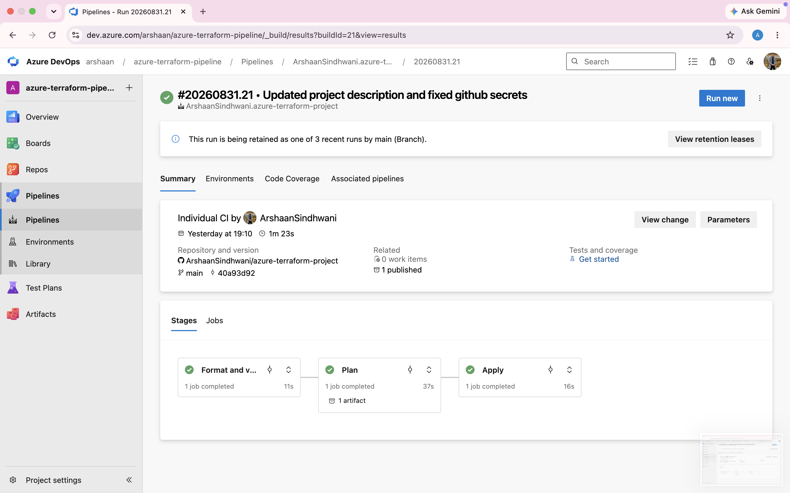
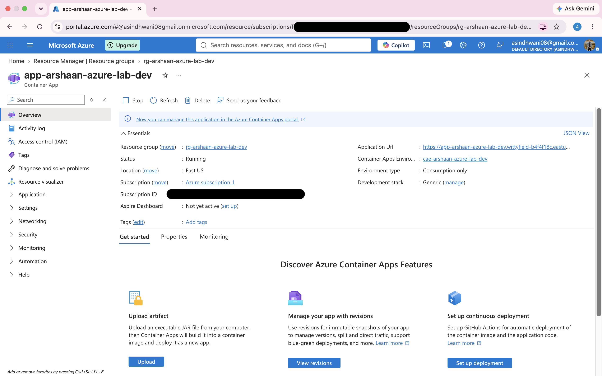
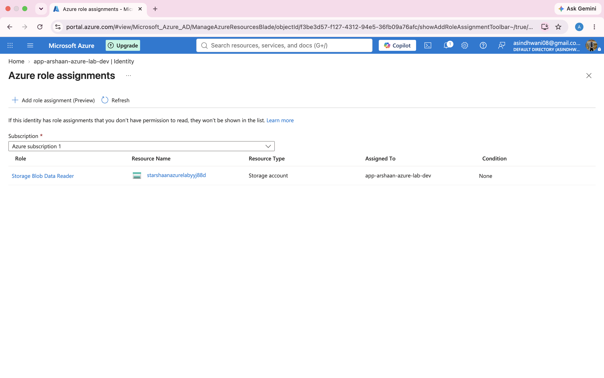

# Azure Terraform Platform Demo

## Overview

A small Azure platform environment built with Terraform. It provisions a resource group, a virtual network with a subnet and network security group, a storage account with a private blob container, and an Azure Container App with a system-assigned managed identity.

It demonstrates infrastructure as code, Azure identity and access management, remote Terraform state and continuous delivery. The Azure DevOps pipeline validates the configuration, creates a saved plan and applies that exact plan for changes pushed to `main`.

## At a glance

| Item | Detail |
| - | - |
| Terraform resources | 10, across 10 resource types |
| Terraform code | 230 lines across 8 files |
| Pipeline stages | Validate, Plan, Apply |
| Verified pipeline run | 3 of 3 stages passed in 1 minute 23 seconds |
| Terraform version in the pipeline | 1.7.5 |

## Design approach

The repository is small enough to read end to end, but it covers the decisions that matter in a real platform environment: how resources are defined, how identities gain access, how changes are reviewed and how deployments are repeated.

- **Infrastructure as code:** Terraform defines the resources, provider requirements, remote state, variables and outputs, so the environment can be reviewed, reproduced and changed through version control.
- **Networking:** A virtual network, application subnet and network security group set out the network boundary and give a starting point for private integration.
- **Workload platform:** Azure Container Apps runs the public sample container on a managed, consumption-based platform, with no virtual machines or App Service Plan to look after.
- **Access management:** The Container App has a system-assigned managed identity with a storage-scoped role. The workload can use an Azure identity instead of a stored storage key, and its permissions are limited to one storage account.
- **Data storage:** A private blob container sits in an LRS storage account with TLS 1.2 as the minimum version.
- **Delivery automation:** Azure DevOps validates, plans, publishes and applies the Terraform. The saved plan separates review from deployment.

Two points are worth stating plainly. The virtual network and network security group are foundation resources: the Container Apps environment is not VNet-integrated, so they do not currently govern traffic to the running app. The hello-world sample image also does not read from Blob Storage yet. The identity and role assignment are in place so a real application can add that without a storage secret.

## What is provisioned

- Resource group `rg-arshaan-azure-lab-dev`
- Virtual network `10.0.0.0/16`
- Application subnet `10.0.1.0/24`
- Network security group with an inbound rule allowing TCP on port 443 (priority 100) and a deny-all inbound rule (priority 4096), associated with the subnet
- Standard LRS storage account with TLS 1.2 as the minimum version
- Private `app-data` blob container
- Azure Container Apps environment and a public Container App
- System-assigned managed identity for the Container App
- `Storage Blob Data Reader` role assignment scoped to the storage account

The network rules are defined in Terraform. The environment is no longer deployed, so they are not currently running in Azure.

### Terraform resources

| Area | Resources |
| - | - |
| Foundation | `azurerm_resource_group.main` |
| Networking | `azurerm_virtual_network.main`, `azurerm_subnet.app`, `azurerm_network_security_group.app`, `azurerm_subnet_network_security_group_association.app` |
| Storage | `azurerm_storage_account.main`, `azurerm_storage_container.app_data` |
| Workload | `azurerm_container_app_environment.main`, `azurerm_container_app.main` |
| Access control | `azurerm_role_assignment.app_storage_reader` |

## Architecture

```text
Git repository
    |
    v
Azure DevOps pipeline: Validate -> Plan -> Apply
    |
    v
Resource group
    |
    + Virtual network
    |  + Application subnet and network security group
    |
    + Storage account
    |  + Private app-data container
    |
    + Container Apps environment
       + Public Container App
         + System-assigned managed identity
           + Storage Blob Data Reader on the storage account
```

The sample container image is Azure's public Container Apps hello-world image. The managed identity and role assignment give the app permission to read blobs once storage access is added to the application.

## CI/CD

The main pipeline is [azure-pipelines.yml](azure-pipelines.yml). It runs when a change is pushed to `main` and has three stages:

1. **Validate** installs Terraform, initialises without the remote backend, checks formatting and validates the configuration.
2. **Plan** initialises the Azure Storage backend, creates `tfplan` and publishes it as a pipeline artefact.
3. **Apply** runs only for `main`, downloads the saved artefact, reinitialises the backend and applies that same plan.



A verified run completed Validate, Plan and Apply in 1 minute 23 seconds. The Azure subscription has since expired, so the environment is no longer deployed and neither pipeline can run to completion at present.

The apply job targets the Azure DevOps `production` environment, where approval checks can be added if a manual release gate is wanted. Terraform runs with `-auto-approve` because it applies the saved plan instead of prompting.

A GitHub Actions workflow in [.github/workflows/terraform.yml](.github/workflows/terraform.yml) is included as an alternative. It follows the same validate, plan and apply pattern and adds a pull request trigger. It has 18 runs in its history, and the most recent one failed on a Terraform state lock. I have not investigated further because the environment is no longer deployed.

## State and authentication

Terraform state is stored remotely in an Azure Storage container, configured in [backend.tf](backend.tf). The state storage account and container must exist before the first pipeline run.

Both pipelines authenticate with the standard `ARM_CLIENT_ID`, `ARM_CLIENT_SECRET`, `ARM_SUBSCRIPTION_ID` and `ARM_TENANT_ID` values. Azure DevOps reads them as pipeline variables and GitHub Actions as repository secrets. None of them are committed to this repository, and state files, plans and `terraform.tfvars` are excluded through `.gitignore`.

The Container App uses a system-assigned managed identity. Terraform grants it only `Storage Blob Data Reader` on this project's storage account, and no storage access keys or connection strings appear in the Container App configuration.





## Prerequisites

- Terraform 1.7 or later
- An Azure subscription with permission to create the resources above
- An existing Azure Storage backend matching `backend.tf`
- Azure credentials available locally or supplied as pipeline variables

## Running locally

Copy the example variables file and adjust it if needed:

```sh
cp terraform.tfvars.example terraform.tfvars
```

Then initialise, check, plan and apply:

```sh
terraform init
terraform fmt -check -recursive
terraform validate
terraform plan
terraform apply
```

The resource group location is set directly to `eastus` in `resource_group.tf`. The `location` variable is kept for future use and no resource reads it yet.

## Repository layout

```text
backend.tf                 Remote Azure Storage state configuration
providers.tf               Terraform and provider version requirements
resource_group.tf          Resource group
network.tf                 Virtual network, subnet and network security group
storage.tf                 Storage account and private blob container
compute.tf                 Container Apps environment, app, identity and role assignment
variables.tf               Input variables
outputs.tf                 Deployment outputs
azure-pipelines.yml        Azure DevOps CI/CD pipeline
.github/workflows/         GitHub Actions alternative workflow
docs/screenshots/          Pipeline and Azure portal screenshots
```

## Possible next steps

- Integrate the Container Apps environment with the virtual network so the network security group applies to the workload
- Replace the sample image with an application that reads from Blob Storage using its managed identity
- Add Azure Key Vault for secrets that cannot use managed identity
- Add Azure Policy and diagnostic settings for a more production-ready baseline
